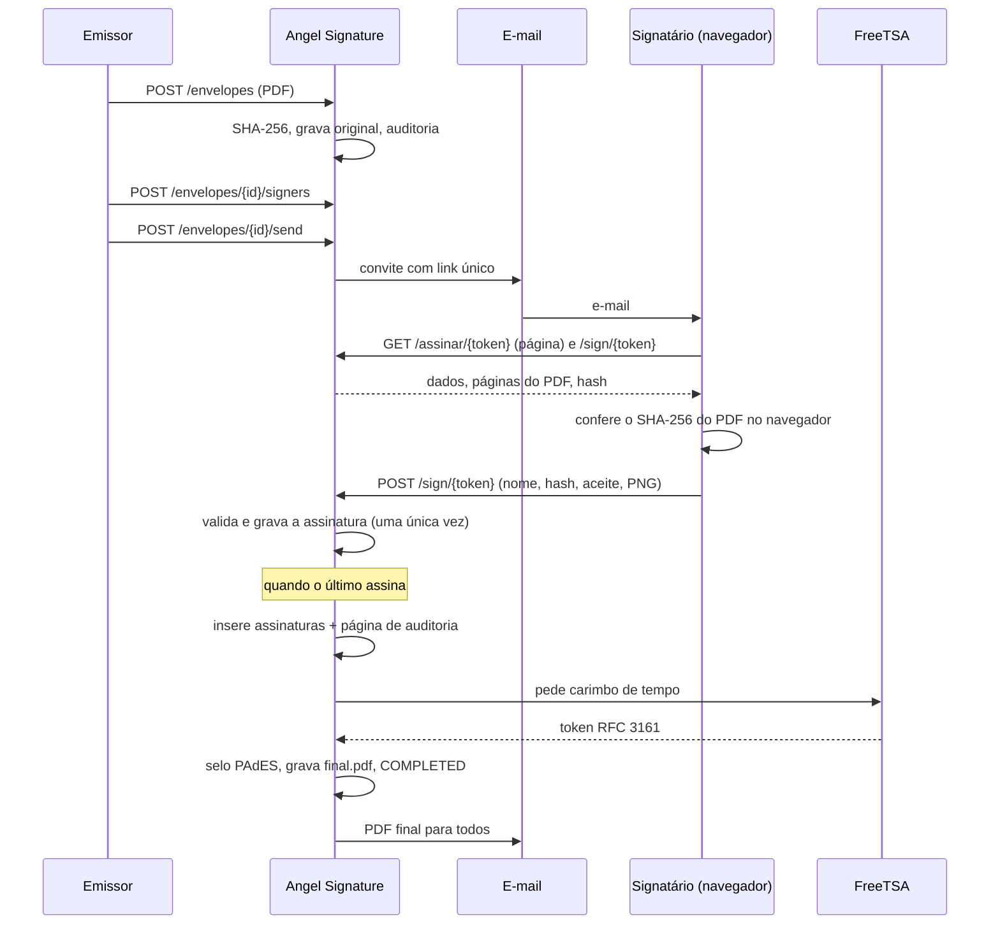

# angel-signature

> **Angel Signature — Anjos Tecnologia**
> Serviço de assinatura eletrônica de documentos PDF, construído sobre o **SiCA**
> (Sistema de Compartilhamento de Arquivos via sockets TCP).

| | |
|---|---|
| **Projeto** | Projeto Integrador — PUC Goiás |
| **Curso** | Análise e Desenvolvimento de Sistemas |
| **Professor** | Prof. Esp. Thalles Bruno |
| **Alunos** | Livia, Kassia, Luciana, Igor e Gustavo |
| **Empresa parceira** | Angel Signature — Anjos Tecnologia |

---

## Sumário

**Para entender o projeto**
- [Em poucas palavras](#em-poucas-palavras)
- [Como funciona, passo a passo](#como-funciona-passo-a-passo)
- [Como a comunicação é protegida (SSL/TLS)](#como-a-comunicação-é-protegida-ssltls)
- [Como rodar em 3 passos](#como-rodar-em-3-passos)
- [Painel web](#painel-web)
- [O que torna a assinatura válida](#o-que-torna-a-assinatura-válida)
- [Glossário](#glossário)
- [Validade jurídica e limitações](#validade-jurídica-e-limitações)
- [Termos de Privacidade e Uso](#termos-de-privacidade-e-uso)
- [Status e próximos passos](#status-e-próximos-passos)

**Parte técnica**
- [Arquitetura](#arquitetura) · [Fluxo da assinatura](#fluxo-da-assinatura) · [Tecnologias](#tecnologias)
- [Execução manual](#execução-manual-passo-a-passo) · [Segurança em detalhe](#segurança-em-detalhe)
- [Base do projeto: SiCA](#base-do-projeto-sica-sockets-tcp) · [API](#api) · [Testes](#testes)
- [Estrutura do projeto](#estrutura-do-projeto)
- [Configuração e variáveis de ambiente](#configuração-e-variáveis-de-ambiente)

---

## Em poucas palavras

Contratos ainda circulam em papel, por e-mail ou por WhatsApp. Fica difícil saber **quem**
assinou, **quando**, e se o documento foi alterado depois.

O **Angel Signature** resolve isso de um jeito simples: a empresa envia um PDF, cada pessoa
recebe um **link por e-mail**, assina **no próprio navegador** (sem instalar nada e sem criar
conta) e, no fim, o sistema entrega **um PDF final** com todas as assinaturas, uma **página
de auditoria** e um **selo digital** que denuncia qualquer alteração posterior.

Por baixo, o sistema é uma aplicação **cliente-servidor**: um **servidor** guarda e entrega
os arquivos, e os **clientes** (a linha de comando e o painel web) conversam com ele pela rede.
Essa conversa é **cifrada com TLS**, o mesmo "cadeado" dos sites de banco.

---

## Como funciona, passo a passo

Exemplo: a empresa quer que **Maria** e **João** assinem um contrato.

1. **A empresa (emissor)** entra no painel, envia o PDF e cadastra Maria e João com seus
   e-mails.
2. **Maria e João** recebem um e-mail com um **link só deles**. Ao clicar, veem o documento,
   digitam o nome, desenham a assinatura e confirmam. Cada link **só funciona uma vez**.
3. **Quando o último assina**, o sistema monta o **PDF final**: assinaturas nos campos,
   página de auditoria (quem, quando, de onde) e um selo digital com carimbo de tempo.
4. **O PDF final** vai por e-mail para todos e fica disponível no servidor de arquivos, onde
   pode ser listado e baixado a qualquer momento.

```
 Empresa ──PDF──▶ [ Angel Signature ] ──e-mail com link──▶ Maria, João
                         │                                     │
                         │◀──────── assinam no navegador ──────┘
                         ▼
                PDF final assinado + auditoria
```

Tudo usa ferramentas **gratuitas**. O certificado digital incluído é **de teste**. Trocar
por um certificado **A1 ICP-Brasil** real é só configuração, sem mexer no código.

---

## Como a comunicação é protegida (SSL/TLS)

**A ideia.** Enviar dados pela rede sem proteção é como mandar uma **carta sem envelope**:
quem estiver no caminho consegue ler e até alterar. O **TLS** (sucessor do SSL) funciona como
um **envelope lacrado que só o destinatário abre**. Também confirma que o destinatário é
quem diz ser. É o cadeado que você vê no navegador.

**Onde o projeto usa.** Há duas conversas na rede, e as duas são cifradas:

```
  Navegador ══ (1) HTTPS ══▶ [ Gateway web ] ══ (2) TLS ══▶ [ Servidor de arquivos SiCA ]
                                    ▲                                  ▲
  Linha de comando ═════════════ (2) TLS ═════════════════════════════╯

  ═══  trecho cifrado
```

1. **Navegador ↔ painel (HTTPS):** protege o painel, os documentos e os links de assinatura.
2. **Painel e linha de comando ↔ servidor de arquivos (TLS sobre TCP):** protege o envio,
   a listagem e o download dos arquivos. **Este trecho andava em texto puro e agora também
   é cifrado.**

**O que acontece quando alguém se conecta** (leva milissegundos):

1. O servidor mostra o seu **certificado**, como um documento de identidade.
2. O cliente confere duas coisas: se o certificado foi emitido por uma **autoridade em que
   ele confia** e se o **nome** bate com o do servidor que ele quis acessar.
3. Os dois combinam uma **chave secreta** só da conversa.
4. A partir daí, tudo o que trafega é **cifrado** e protegido contra alteração.

**O que o sistema recusa:**

| Situação | Resultado |
|---|---|
| Servidor com certificado de uma autoridade desconhecida | Cliente **recusa** a conexão |
| Servidor com nome diferente do certificado (possível impostor) | Cliente **recusa** a conexão |
| Conexão sem cifra (texto puro) no servidor de arquivos | **Não funciona** |
| Versões antigas e inseguras do protocolo (TLS 1.1 ou menor) | **Recusadas** |

**Por que o navegador avisa "conexão não segura"?** Porque o certificado do projeto foi
emitido por uma **autoridade de teste**, criada por nós, e o navegador não a conhece. A
cifra funciona normalmente. Para uso real, basta um certificado de uma autoridade pública
reconhecida. Para a demonstração, aceite o aviso ou importe `certs/ac-teste.crt`.

> O que o TLS **não** faz: ele não identifica *quem é o usuário* do servidor de arquivos.
> Hoje o acesso ao painel exige a chave de administrador, mas quem chega direto à porta TCP
> e confia na autoridade pode listar e baixar arquivos. Por isso a porta não deve ser exposta
> na internet. Detalhes em [Segurança em detalhe](#segurança-em-detalhe).

---

## Como rodar em 3 passos

Você precisa de **Java 17 ou superior**, **Maven** e **OpenSSL** instalados.

**1. Baixe o projeto e entre na pasta**

```bash
git clone git@github.com:LiviaMor/client-server.git
cd client-server
```

**2. Rode o script de início**

```bash
scripts/iniciar.sh
```

Na **primeira vez**, o script faz o trabalho chato por você: cria o arquivo `.env` com uma
chave de acesso e senhas geradas, cria os certificados de teste, compila o projeto e liga o
servidor de arquivos e o painel. Nas próximas, só liga.

**3. Abra o painel**

Acesse **https://localhost:8080** no navegador **do mesmo computador**. Aceite o aviso do
certificado de teste e digite a **chave de acesso**. Para ver a chave: `grep ADMIN_KEY .env`.

Para parar tudo, aperte **Ctrl+C** no terminal.

**Dicas para não travar:**

- **Os e-mails não chegam?** Por padrão o sistema não envia e-mail de verdade. O **link de
  assinatura aparece no terminal**. Para enviar e-mails reais, veja a configuração do Resend
  no [guia do `.env`](#guia-de-preenchimento-do-env).
- **Abriu o link no celular e não funcionou?** No celular, `localhost` é o próprio celular.
  Use o IP do computador. Veja o [guia do `.env`](#guia-de-preenchimento-do-env).
- **Sem internet?** Dá para trabalhar desligando o carimbo de tempo com `TSA_URL=none`.
- Todas as configurações ficam no arquivo `.env`, explicadas no final deste documento.

---

## Painel web

Ao abrir `https://localhost:8080`, o emissor informa a **chave de administrador**
(`ADMIN_KEY`) e acessa três áreas:

| Área | O que faz |
|---|---|
| **Compartilhamento** | Envia, lista e baixa arquivos do servidor SiCA (sockets TCP) |
| **Assinaturas** | Cria o documento (título + PDF + signatários), envia ou reenvia os convites, finaliza e baixa o PDF assinado |
| **Auditoria** | Indicadores (enviados, aguardando, concluídos, recusados), **quem assinou** em cada documento e a trilha de eventos (data, signatário, IP, navegador, hash) |

A tela de entrada mostra a logo e o slogan *"Sua assinatura, protegida."*. O rodapé
traz o link para os [Termos de Privacidade e Uso](#termos-de-privacidade-e-uso)
(`/termos`). Os signatários não usam o painel: eles abrem o link recebido por e-mail
(`/assinar/{token}`).

O frontend é HTML, CSS e JavaScript puros, com visual no estilo shadcn/ui (tema claro,
azul da logo). Os arquivos ficam em `src/main/resources/painel/` (emissor) e
`src/main/resources/assinatura-web/` (signatário). Todo texto vindo do servidor entra
na página por `textContent`, e a política CSP bloqueia scripts e estilos inline.

---

## O que torna a assinatura válida

O desenho na tela é **apenas uma imagem**. A validade vem do **conjunto de
evidências** registrado pelo serviço:

| Evidência | O que prova |
|---|---|
| **Hash SHA-256** do documento, conferido no navegador e no servidor | O signatário assinou exatamente o documento que viu |
| **Link único e secreto** por signatário (guardado só como hash) | Acesso ao e-mail do signatário |
| **Nome digitado**, conferido com o do convite | Ato afirmativo de identificação |
| **Trilha de auditoria** imutável (data/hora, IP, navegador, hash) | Quem fez o quê e quando |
| **Selo digital PAdES** com o certificado do serviço | Qualquer alteração posterior no PDF é detectável |
| **Carimbo de tempo RFC 3161** (FreeTSA) | Quando o documento foi finalizado, atestado por terceiro |

---

## Glossário

| Termo | Em palavras simples |
|---|---|
| **Cliente-servidor** | Um programa (servidor) oferece um serviço e outros (clientes) o usam pela rede |
| **Socket TCP** | A "linha telefônica" entre cliente e servidor: conexão confiável pela rede |
| **TLS / SSL** | A cifra que protege a conversa. SSL é o nome antigo; hoje se usa TLS |
| **HTTPS** | O site comum (HTTP) protegido por TLS. É o cadeado do navegador |
| **Certificado** | Documento digital que prova a identidade de um servidor |
| **AC (autoridade certificadora)** | Quem emite e garante certificados. Aqui usamos uma AC de teste |
| **Hash (SHA-256)** | A "impressão digital" de um arquivo: se um byte mudar, o hash muda |
| **Token / link único** | Código secreto no link do e-mail, que vale para uma pessoa e uma assinatura |
| **PAdES** | Padrão de selo digital em PDF: qualquer alteração depois do selo é detectada |
| **Carimbo de tempo (RFC 3161)** | Prova, atestada por terceiro, de quando o documento foi finalizado |
| **Trilha de auditoria** | Registro de quem fez o quê, quando e de onde, que não pode ser apagado |
| **`.env`** | Arquivo local com as configurações e senhas. Nunca vai para o Git |

---

## Validade jurídica e limitações

- Trata-se de **assinatura eletrônica** (simples/avançada), nos termos da
  **MP 2.200-2/2001** e da **Lei 14.063/2020**. Não é assinatura qualificada
  ICP-Brasil do signatário.
- O selo PAdES é do **serviço**, não do signatário: ele garante integridade e
  data, não a identidade pessoal.
- A identificação baseia-se no **acesso ao e-mail**. Quem receber o link
  encaminhado consegue assinar; por isso o link é pessoal, expira e o nome
  digitado é registrado.
- O certificado incluído é **de teste**. Em produção, use um certificado A1 da
  empresa e HTTPS.

---

## Termos de Privacidade e Uso

A página `/termos` descreve, com base no que o sistema realmente faz: os dados tratados
(nome, e-mail, imagem da assinatura, IP, navegador, hash), finalidades e bases legais da LGPD,
compartilhamento (Resend e FreeTSA), medidas de segurança, validade das assinaturas,
retenção e direitos do titular. É uma **versão de demonstração** e deve ser revisada pela
área jurídica da Anjos Tecnologia antes de uso comercial. Falta definir o e-mail do
encarregado de dados (marcador em `src/main/resources/painel/termos.html`).

---

## Status e próximos passos

| Etapa | Situação |
|---|---|
| 0. Fundação (Maven, SQLite, certificado de teste) | ✅ Concluída |
| 1. Envelopes e hash | ✅ Concluída |
| 2. Signatários e envio de convites | ✅ Concluída |
| 3. Tela do signatário e assinatura única | ✅ Concluída |
| 4. PDF final com selo PAdES e carimbo de tempo | ✅ Concluída |
| Comunicação segura (HTTPS/TLS no servidor web) | ✅ Concluída |
| Painel web do emissor (compartilhamento, assinaturas e auditoria) | ✅ Concluído |
| Termos de Privacidade e Uso (`/termos`) | ✅ Publicado — falta revisão jurídica e definir o contato do encarregado |
| Rotas do SiCA protegidas por chave | ✅ Concluída |
| 5. Verificação pública (`POST /verify`) e página de consulta | ⏳ Pendente — o verificador já existe; falta expor a rota e a página |
| TLS no canal TCP do SiCA (cliente de linha de comando, gateway e servidor) | ✅ Concluída |
| Script único de inicialização (`scripts/iniciar.sh`) | ✅ Concluída |
| Roteiro de entrevista com a empresa (`docs/ROTEIRO-ENTREVISTA-ANGEL.md`) | ✅ Pronto — falta aplicar |
| 6. Expiração, cancelamento e acabamento | ⏳ Pendente |

Ideias para o futuro: código OTP além do link, ordem de assinatura, marcação visual dos
campos de assinatura no PDF, webhooks, exclusão/retenção de dados, OCR para PDFs
escaneados e assinatura qualificada ICP-Brasil do signatário.
Detalhes em [`docs/PLANO-ASSINATURA.md`](docs/PLANO-ASSINATURA.md).

---

# Parte técnica

Daqui em diante estão os detalhes para quem vai manter, auditar ou estender o sistema.

---

## Arquitetura

```
 Navegador (signatário)          Emissor (painel web / curl)
   /assinar/{token}                 X-Admin-Key
        │  HTTP                          │  HTTP
        ▼                                ▼
 ┌──────────────────────────────────────────────────────┐
 │                GatewayWeb (HTTP, Java)               │
 │   /sign/...  (signatário)     /envelopes/... (emissor)│
 │                                                      │
 │   sica.assinatura                                    │
 │   ├── servico     regras: envelope, assinatura,      │
 │   │               finalização                        │
 │   ├── pdf         PDFBox (imagens, manifesto)        │
 │   │               BouncyCastle (selo PAdES, RFC 3161)│
 │   ├── repositorio SQLite (dados + auditoria)         │
 │   └── email       console | Resend (API HTTP)        │
 └───────┬──────────────────┬──────────────────┬────────┘
         │                  │                  │
         ▼                  ▼                  ▼
   storage/<id>/      FreeTSA.org        server-files/
   original.pdf       (carimbo de        (PDF final visível no
   final.pdf          tempo)             LIST/DOWNLOAD do SiCA)
                                               ▲
                                               │ socket TCP
                                      Servidor SiCA / Cliente CLI
```

O núcleo TCP do SiCA continua intacto. O módulo de assinatura é ativado no
`GatewayWeb` somente quando a variável `ADMIN_KEY` está definida.
O `GatewayWeb` também serve o painel (`PainelWeb`) e protege as rotas do SiCA
(`/api/*`) com a mesma chave.

---

## Fluxo da assinatura



Estados do envelope: `DRAFT → SENT → COMPLETED` (desvios: `DECLINED` quando um
signatário recusa; `EXPIRED` e `CANCELED` previstos).
Estados do signatário: `PENDING → VIEWED → SIGNED` (ou `DECLINED`).

---

## Tecnologias

| Camada | Tecnologia |
|---|---|
| Linguagem / build | Java 17 + Maven |
| Servidor HTTP | `com.sun.net.httpserver` (JDK) |
| PDF (imagens, página de auditoria, renderização) | Apache PDFBox 3.0.8 |
| Selo PAdES e carimbo de tempo | BouncyCastle 1.87 |
| Banco de dados | SQLite (`sqlite-jdbc` 3.54.1.0) |
| Carimbo de tempo | [FreeTSA.org](https://freetsa.org) (RFC 3161) |
| E-mail | Console (desenvolvimento) ou [Resend](https://resend.com) (API HTTP) |
| Certificado de teste | OpenSSL (`scripts/gerar-certificado-teste.sh`) |
| Testes | JUnit 6 |
| Frontend (painel do emissor e página do signatário) | HTML + CSS + JavaScript puro, sem frameworks, visual no estilo shadcn/ui |

---

## Execução manual (passo a passo)

O [`scripts/iniciar.sh`](scripts/iniciar.sh) faz tudo isto sozinho. Use os passos abaixo
para entender ou ajustar cada etapa.

### Pré-requisitos

- **JDK 17+** e **Maven** (`java -version`, `mvn -version`)
- **OpenSSL** (para gerar o certificado de teste)
- Acesso à internet para o carimbo de tempo do FreeTSA (ou `TSA_URL=none` em
  desenvolvimento offline)


### 1. Compilar e testar

```bash
mvn clean package
```

### 2. Gerar os certificados de teste

```bash
scripts/gerar-certificado-teste.sh certs     # AC de teste + certificado do selo PAdES
scripts/gerar-certificado-https.sh certs     # certificado HTTPS do servidor (emitido pela mesma AC)
```

Os scripts pedem uma senha e criam, em `certs/`:

- `ac-teste.crt`: AC de teste (pública);
- `servico.p12`: certificado do serviço, usado no selo dos PDFs;
- `https.p12`: certificado TLS do servidor (`localhost`, `127.0.0.1`).

Para abrir o link pelo celular na mesma rede, passe o IP da máquina:
`scripts/gerar-certificado-https.sh certs "" 192.168.0.10`.

A pasta `certs/` está no `.gitignore` e **nunca deve ser versionada**.

> **Aviso do navegador:** como a AC é de teste, o navegador mostra "conexão não
> segura" na primeira vez. Opções: aceitar o aviso na demonstração, importar
> `certs/ac-teste.crt` como AC confiável (o que vale para o site **e** para o
> selo dos PDFs), ou usar o [mkcert](https://github.com/FiloSottile/mkcert):
> `mkcert -install && mkcert -pkcs12 localhost 127.0.0.1`, que gera
> `localhost+1.p12` (senha `changeit`), confiável no navegador local.

### 3. Subir o serviço

Copie o modelo de variáveis e preencha (o `.env` está no `.gitignore` e **nunca deve ser
versionado**):

```bash
cp .env.example .env
# edite o .env: ADMIN_KEY, senhas dos certificados, e (opcional) a chave do Resend
source .env
```

Suba o servidor TCP do SiCA e, em outro terminal, o gateway web:

```bash
# terminal 1: servidor TCP (área de compartilhamento; precisa do .env para o TLS)
source .env
mvn exec:java -Dexec.mainClass=sica.server.Servidor -Dexec.args="5050"

# terminal 2: gateway web (painel + assinatura)
source .env
mvn exec:java -Dexec.mainClass=sica.web.GatewayWeb -Dexec.args="8080 localhost 5050"
# [Gateway] Interface web em https://localhost:8080
```

As variáveis são lidas **apenas na inicialização**: depois de editar o `.env`, rode
`source .env` e reinicie o gateway.

Com `EMAIL_PROVIDER=console` (padrão), **nenhum e-mail é enviado**: a mensagem, com o
**link de assinatura**, aparece no terminal do gateway. Para enviar de verdade, use
`EMAIL_PROVIDER=resend` e a `RESEND_API_KEY`.

### 4. Criar e enviar um envelope

O caminho mais simples é o **painel web** (aba Assinaturas). Pela API, o equivalente é
abaixo; nos exemplos, `--cacert certs/ac-teste.crt` faz o `curl` confiar no
certificado de teste.

```bash
# Cria o envelope com o PDF
curl --cacert certs/ac-teste.crt -H "X-Admin-Key: $ADMIN_KEY" \
     -F "titulo=Contrato de Prestação de Serviços" \
     -F "arquivo=@contrato.pdf" \
     https://localhost:8080/envelopes
# -> {"id":"<ID>", "sha256Original":"...", "status":"DRAFT", ...}

# Adiciona um signatário (coordenadas em pontos do PDF, origem no canto inferior esquerdo)
curl --cacert certs/ac-teste.crt -H "X-Admin-Key: $ADMIN_KEY" \
     -d "nome=Fulano de Tal" -d "email=fulano@exemplo.com" \
     -d pagina=1 -d x=72 -d y=100 -d largura=200 -d altura=60 \
     https://localhost:8080/envelopes/<ID>/signers

# Envia os convites
curl --cacert certs/ac-teste.crt -H "X-Admin-Key: $ADMIN_KEY" -X POST \
     https://localhost:8080/envelopes/<ID>/send
```

Abra o link impresso no terminal (`https://localhost:8080/assinar/<token>`),
assine e, ao final, baixe o PDF selado:

```bash
curl --cacert certs/ac-teste.crt -H "X-Admin-Key: $ADMIN_KEY" -o final.pdf \
     https://localhost:8080/envelopes/<ID>/download
```

> **Leitores de PDF:** com o certificado de teste, o Adobe Reader mostra o selo
> como "não confiável" até que `certs/ac-teste.crt` seja importado como
> certificado confiável. Isso é esperado em demonstrações.

---

## Segurança em detalhe

### Canal web (navegador ↔ gateway)

- **HTTPS/TLS:** o servidor usa o `HttpsServer` do JDK, aceitando apenas **TLS 1.3 e
  TLS 1.2**. O certificado do servidor impede que um intermediário se passe por ele.
  Testado: TLS 1.3 negociado, TLS 1.1 recusado, HTTP simples recusado e cliente que não
  confia no certificado recusado.

### Canal TCP do SiCA (cliente/gateway ↔ servidor de arquivos)

- **TLS com `SSLServerSocket` e `SSLSocket`** (classe `sica.common.Tls`), TLS 1.3 e 1.2.
- **Servidor:** carrega o `https.p12` (`HTTPS_KEYSTORE_PATH` e `HTTPS_KEYSTORE_PASSWORD`).
  **Não sobe sem ele**: o TLS é obrigatório, não há modo texto puro.
- **Cliente** (CLI e gateway): confia **apenas** na AC indicada em `SICA_TLS_CA`
  (padrão `certs/ac-teste.crt`) e ativa a **verificação do nome do servidor**
  (`endpointIdentificationAlgorithm=HTTPS`). O handshake é feito na conexão, então a
  falha aparece logo, e não no meio de uma operação.
- O protocolo do SiCA (`LIST`, `UPLOAD`, `DOWNLOAD`, `SAIR`) **não mudou**: o TLS fica por
  baixo dos streams.
- Testes em `TlsTest`: conversa cifrada em TLS 1.2/1.3, AC desconhecida recusada, nome de
  host diferente recusado e conexão em texto puro sem resposta útil.
- **Limite conhecido:** o protocolo TCP não tem **autenticação de usuário**. Quem confia na
  AC e alcança a porta pode listar e baixar arquivos. Não exponha a porta à internet. Uma
  evolução possível é exigir certificado do cliente (mTLS) ou um token no protocolo.

### Aplicação

- **Tokens** de 32 bytes (`SecureRandom`), armazenados **apenas como hash**.
- **Assinatura única** garantida por atualização atômica no banco, testada com
  requisições simultâneas.
- **Auditoria imutável**: triggers do SQLite bloqueiam `UPDATE` e `DELETE`.
- **Original nunca sobrescrito**; o PDF final é um arquivo novo com hash próprio.
- **Chave privada fora do repositório** (`certs/`, `*.p12`, `*.pfx` no `.gitignore`).
- **Validação de entrada**: PDF por assinatura de bytes e leitura completa; PNG
  com limite de dimensões antes de decodificar; tamanho máximo de requisição;
  nomes de arquivo nunca usados em caminhos (sem *path traversal*).
- **Página do signatário** com CSP restritiva, `X-Frame-Options: DENY`,
  `Referrer-Policy: no-referrer` e `Cache-Control: no-store`.
- **Limite de requisições** por IP nas rotas públicas.
- **Rotas do SiCA protegidas:** `/api/list`, `/api/upload` e `/api/download` exigem a chave de
  administrador (sem ela respondem 401). O painel mantém a chave só na sessão do navegador.
- **Painel** com CSP restritiva (`script-src`/`style-src` apenas `self`), `X-Frame-Options: DENY`
  e `no-store`.
- Comparação da chave de administrador em tempo constante.

---

## Base do projeto: SiCA (sockets TCP)

O angel-signature nasceu do **SiCA — Sistema de Compartilhamento de Arquivos**,
atividade da disciplina de Desenvolvimento de Software Cliente/Servidor.
O SiCA continua funcionando de forma independente:

| Requisito original | Onde é atendido |
|---|---|
| Sockets TCP entre cliente e servidor | `Servidor`, `ClienteHandler`, `Cliente` |
| Enviar arquivo (upload) | Comando `UPLOAD` |
| Listar arquivos | Comando `LIST` |
| Baixar arquivo (download) | Comando `DOWNLOAD` |
| Várias conexões | Uma thread por cliente (`ClienteHandler`) |

### Protocolo TCP

| Comando | Cliente envia | Servidor responde |
|---|---|---|
| `LIST` | `"LIST"` | `int qtd` + `qtd` × (`String nome`, `long tamanho`) |
| `UPLOAD` | `"UPLOAD"`, `String nome`, `long tamanho`, bytes | `String status`, `String mensagem` |
| `DOWNLOAD` | `"DOWNLOAD"`, `String nome` | `String status`; se `OK`: `long tamanho` + bytes |
| `SAIR` | `"SAIR"` | encerra a conexão |

### Executar o SiCA manualmente

```bash
mvn clean package
source .env   # necessário: o TLS do canal TCP lê o certificado do .env

# Servidor TCP (no macOS a porta 5000 costuma estar ocupada pelo AirPlay; use 5050)
mvn exec:java -Dexec.mainClass=sica.server.Servidor -Dexec.args="5050"

# Cliente de linha de comando (outro terminal, também com 'source .env')
mvn exec:java -Dexec.mainClass=sica.client.Cliente -Dexec.args="localhost 5050"

# Interface web (outro terminal): https://localhost:8080 (aba Compartilhamento; pede a ADMIN_KEY)
source .env
mvn exec:java -Dexec.mainClass=sica.web.GatewayWeb -Dexec.args="8080 localhost 5050"
```

Os PDFs finais assinados são publicados em `server-files/` e aparecem
automaticamente no `LIST` e no `DOWNLOAD` do SiCA.

---

© Angel Signature — Anjos Tecnologia · Projeto Integrador PUC Goiás
cd /Users/liviamor/Developer/cliente-server
  source .env
  mvn exec:java -Dexec.mainClass=sica.server.Servidor -Dexec.args="5050"          # terminal 1
  mvn exec:java -Dexec.mainClass=sica.web.GatewayWeb -Dexec.args="8080 localhost 5050"   # terminal 2 (com source .env)

---

## API

### Emissor (cabeçalho `X-Admin-Key`)

| Método | Rota | Descrição |
|---|---|---|
| GET | `/envelopes` | Lista os envelopes (mais recentes primeiro, até 200) com seus signatários |
| POST | `/envelopes` | Cria envelope (multipart: `titulo`, `arquivo`) |
| GET | `/envelopes/{id}` | Status do envelope e dos signatários |
| POST | `/envelopes/{id}/signers` | Adiciona signatário (`nome`, `email`, `pagina`, `x`, `y`, `largura`, `altura`) |
| POST | `/envelopes/{id}/send` | Envia ou reenvia convites (o reenvio invalida os links anteriores) |
| POST | `/envelopes/{id}/finalize` | Repete a finalização (ex.: se a TSA estava fora do ar) |
| GET | `/envelopes/{id}/download` | Baixa o PDF final selado |
| GET | `/envelopes/{id}/audit` | Trilha de auditoria (JSON) |

### Compartilhamento SiCA (cabeçalho `X-Admin-Key`)

| Método | Rota | Descrição |
|---|---|---|
| GET | `/api/list` | Lista os arquivos do servidor TCP |
| POST | `/api/upload` | Envia um arquivo (multipart) |
| GET | `/api/download?nome=...` | Baixa um arquivo |

### Páginas públicas

| Método | Rota | Descrição |
|---|---|---|
| GET | `/` | Painel do emissor (pede a chave na entrada) |
| GET | `/termos` | Termos de Privacidade e Uso |

### Signatário (o token do link é a credencial)

| Método | Rota | Descrição |
|---|---|---|
| GET | `/assinar/{token}` | Página de assinatura (deep link) |
| GET | `/sign/{token}` | Dados do convite (registra a visualização) |
| GET | `/sign/{token}/documento` | PDF original |
| GET | `/sign/{token}/paginas/{n}` | Página renderizada em PNG |
| POST | `/sign/{token}` | Assina (multipart: `nome`, `sha256`, `aceite=true`, `assinatura` PNG) |
| POST | `/sign/{token}/decline` | Recusa com `motivo` |
| GET | `/sign/{token}/final` | PDF final, após a conclusão |

Erros seguem o formato `{"erro": "mensagem"}`, com códigos HTTP 400, 401, 404,
405, 409, 410 (link expirado), 413, 429 (limite de requisições) e 503
(finalização temporariamente indisponível).

---

## Testes

```bash
mvn clean package
```

São **140 testes** JUnit, incluindo:

- servidor HTTPS: TLS válido, recusa de HTTP simples, de TLS antigo e de
  certificado não confiável;
- canal TCP (`TlsTest`): conversa cifrada, AC desconhecida, nome de host errado e texto puro;
- assinatura com hash diferente, link expirado, segunda assinatura e oito
  assinaturas simultâneas do mesmo link (apenas uma é aceita);
- adulteração de 1 byte e conteúdo acrescentado depois do selo (detectados);
- TSA fora do ar (a assinatura não se perde e a finalização pode ser repetida);
- fluxo HTTP completo com certificado `.p12` e uma TSA RFC 3161 local;
- listagem de envelopes e proteção das rotas pela chave de administrador.

O PDF final também foi validado com uma ferramenta externa (`pdfsig`, do
poppler): *"Signature is Valid"* e *"Total document signed"*.

---

## Estrutura do projeto

```
angel-signature/
├── pom.xml
├── scripts/iniciar.sh                   # sobe tudo (cria .env e certificados na 1ª vez)
├── scripts/gerar-certificado-teste.sh   # AC de teste + certificado do serviço
├── scripts/gerar-certificado-https.sh   # certificado TLS do servidor web
├── .env.example                         # modelo das variáveis de ambiente (o .env não é versionado)
├── docs/
│   ├── PLANO-ASSINATURA.md              # plano e decisões de implementação
│   ├── AMBIENTE-E-ARQUITETURA.md        # variáveis de ambiente e padrão de arquitetura
│   ├── ROTEIRO-ENTREVISTA-ANGEL.md      # perguntas para o levantamento com a empresa
│   └── interface-web.png
├── src/main/java/sica/
│   ├── assinatura/                      # módulo de assinatura eletrônica
│   │   ├── config/      Configuracao (variáveis de ambiente)
│   │   ├── modelo/      Envelope, Signatario, EventoAuditoria...
│   │   ├── repositorio/ SQLite (JDBC)
│   │   ├── servico/     envelopes, signatários, assinatura, finalização
│   │   ├── pdf/         montagem, selo PAdES, carimbo de tempo, verificação
│   │   ├── email/       console e Resend
│   │   ├── seguranca/   hashes e tokens
│   │   └── web/         rotas HTTP do emissor e do signatário
│   ├── server/          servidor TCP do SiCA
│   ├── client/          cliente CLI do SiCA
│   ├── common/          protocolo TCP e Tls (sockets TCP cifrados)
│   └── web/             GatewayWeb (HTTP), PainelWeb (painel), ServidorHttp (TLS)
├── src/main/resources/painel/           # painel do emissor, logo e /termos (HTML/CSS/JS)
├── src/main/resources/assinatura-web/   # página do signatário (HTML/CSS/JS)
└── src/test/java/                       # testes JUnit
```

---

## Configuração e variáveis de ambiente

### Guia de preenchimento do `.env`

O `.env` guarda as configurações e os segredos. Ele **não vai para o Git**. Os campos que
você precisa conhecer:

| Variável | O que colocar | Onde conseguir |
|---|---|---|
| `ADMIN_KEY` | Uma chave forte, que você digita na tela de entrada do painel | Invente: `openssl rand -hex 16` |
| `SIGNING_CERT_PASSWORD` | Senha do `certs/servico.p12` (selo dos PDFs) | Escolha uma. É a mesma usada ao gerar o certificado |
| `HTTPS_KEYSTORE_PASSWORD` | Senha do `certs/https.p12` (HTTPS e TLS do TCP) | Escolha uma. É a mesma usada ao gerar o certificado |
| `EMAIL_PROVIDER` | `console` (o link aparece no terminal) ou `resend` (envia e-mail de verdade) | Comece com `console` |
| `RESEND_API_KEY` | Só se `EMAIL_PROVIDER=resend` | Crie uma conta em [resend.com](https://resend.com) → *API Keys* |
| `EMAIL_FROM` | Remetente dos e-mails | Com o Resend sem domínio próprio, mantenha o padrão |
| `BASE_URL` | Endereço que aparece nos links dos e-mails | `https://localhost:8080` se abrir o link no mesmo computador |
| `SICA_TLS_CA` | AC em que o cliente TCP confia | Já vem com `certs/ac-teste.crt` |

Regras que evitam os problemas mais comuns:

- **Link do e-mail aberto no celular:** `localhost` aponta para o próprio celular e não
  funciona. Use o IP do computador no `BASE_URL` (ex.: `https://192.168.0.10:8080`) e gere
  o certificado com esse IP: `scripts/gerar-certificado-https.sh certs "" 192.168.0.10`.
- **Resend sem domínio verificado:** só entrega ao e-mail da própria conta do Resend.
- **Sem internet:** coloque `export TSA_URL="none"` para desativar o carimbo de tempo.
- **Depois de editar o `.env`:** reinicie com `scripts/iniciar.sh`. As variáveis só são lidas
  na inicialização.
- **Nunca** envie o `.env`, a pasta `certs/` ou os `.p12` para o Git. Já estão no `.gitignore`.

### Referência completa

> Referência completa (obrigatoriedade, o que acontece quando falta, perfis de uso) e o padrão de
> arquitetura em [`docs/AMBIENTE-E-ARQUITETURA.md`](docs/AMBIENTE-E-ARQUITETURA.md).

| Variável | Padrão | Descrição |
|---|---|---|
| `ADMIN_KEY` | — | **Obrigatória** para ativar o módulo. Chave das rotas do emissor (`X-Admin-Key`) |
| `HTTPS_KEYSTORE_PATH` | — | Certificado TLS do servidor (`.p12`), usado no HTTPS e no TLS do canal TCP. Sem ele o gateway usa HTTP sem criptografia (só desenvolvimento) e o **servidor TCP não sobe** |
| `HTTPS_KEYSTORE_PASSWORD` | — | Senha do certificado TLS |
| `SIGNING_CERT_PATH` | — | Arquivo `.p12`/`.pfx` do certificado. Sem ele, a finalização fica desativada |
| `SIGNING_CERT_PASSWORD` | — | Senha do `.p12` |
| `TSA_URL` | `https://freetsa.org/tsr` | Servidor RFC 3161. `none` desativa (só desenvolvimento) |
| `BASE_URL` | `http://localhost:8080` | Endereço público usado nos links dos e-mails |
| `EMAIL_PROVIDER` | `console` | `console` (só imprime no terminal) ou `resend` (envia de verdade) |
| `RESEND_API_KEY` | — | Chave do Resend (obrigatória com `EMAIL_PROVIDER=resend`) |
| `EMAIL_FROM` | `Angel Signature <onboarding@resend.dev>` | Remetente |
| `SICA_DB_PATH` | `data/assinatura.db` | Banco SQLite |
| `SICA_TLS_CA` | `certs/ac-teste.crt` | AC em que o cliente TCP (CLI e gateway) confia para validar o servidor |
| `SICA_STORAGE_DIR` | `storage` | PDFs originais e finais |
| `SICA_SERVER_FILES_DIR` | `server-files` | Onde o PDF final é publicado para o SiCA (`none` desativa) |
| `MAX_PDF_BYTES` | `20971520` (20 MB) | Tamanho máximo do PDF |
| `TOKEN_VALIDADE_DIAS` | `7` | Validade do link de assinatura |

> **Resend:** sem domínio verificado, o Resend só entrega e-mails ao endereço da
> própria conta. Para enviar a outras pessoas é preciso verificar um domínio.
> Não é necessário MCP: o serviço chama a API HTTP do Resend diretamente.

---

© Angel Signature — Anjos Tecnologia · Projeto Integrador PUC Goiás
