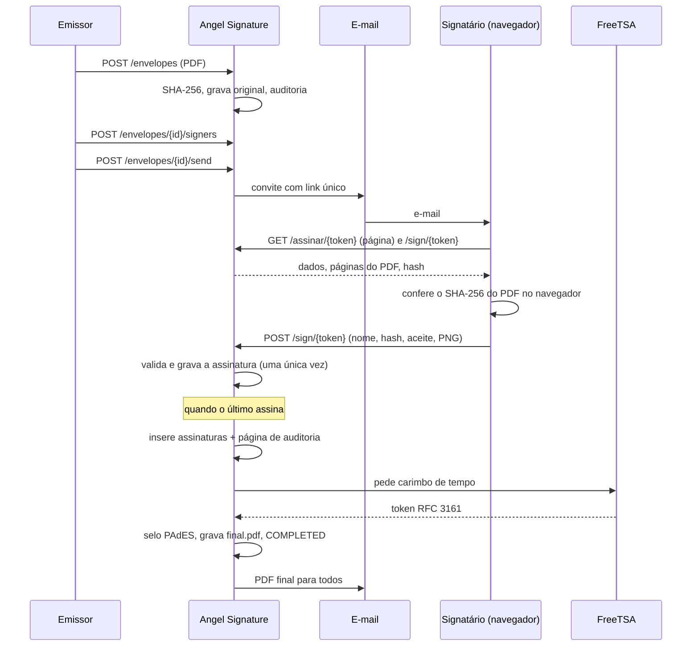
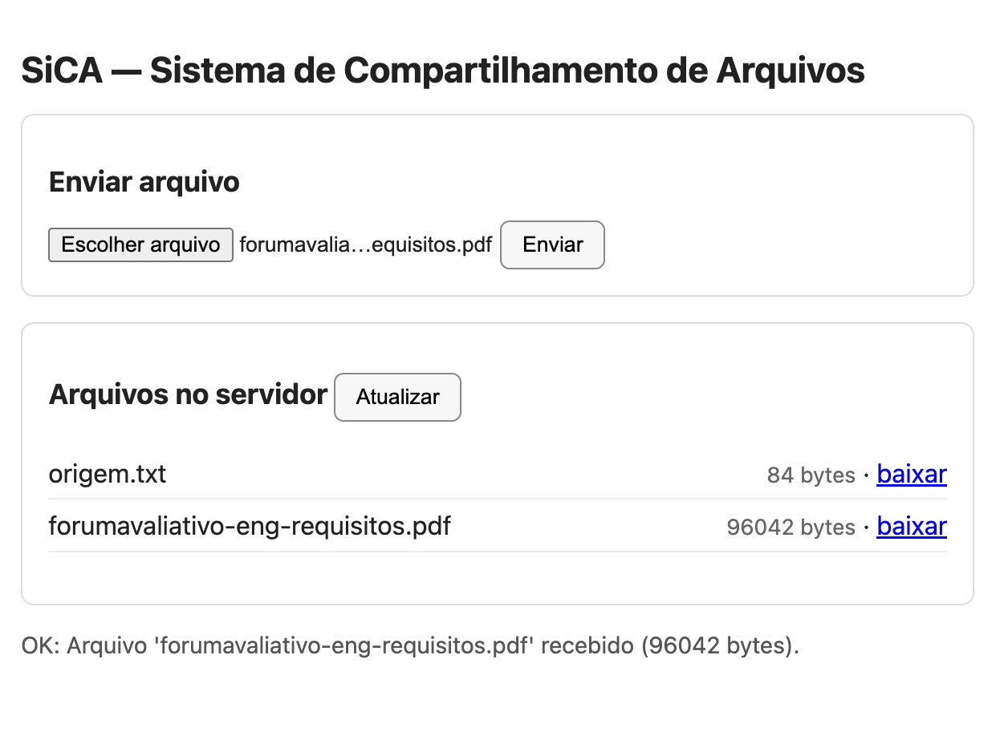

# angel-signature

> **Angel Signature — Anjos Tecnologia**
> Serviço de assinatura eletrônica de documentos PDF, construído sobre o **SiCA**
> (Sistema de Compartilhamento de Arquivos via sockets TCP).

| | |
|---|---|
| **Projeto** | Projeto Integrador — PUC Goiás |
| **Curso** | Análise e Desenvolvimento de Sistemas |
| **Professor** | Prof. Esp. Thalles Bruno |
| **Alunos** | Livia, Kassia, Luciana, Igor e Gustavo |
| **Empresa parceira** | Angel Signature — Anjos Tecnologia |

---

## Sumário

- [Visão geral](#visão-geral)
- [O que torna a assinatura válida](#o-que-torna-a-assinatura-válida)
- [Arquitetura](#arquitetura)
- [Fluxo da assinatura](#fluxo-da-assinatura)
- [Tecnologias](#tecnologias)
- [Como executar](#como-executar)
- [Configuração (variáveis de ambiente)](#configuração-variáveis-de-ambiente)
- [API](#api)
- [Segurança](#segurança)
- [Testes](#testes)
- [Estrutura do projeto](#estrutura-do-projeto)
- [Status e próximos passos](#status-e-próximos-passos)
- [Validade jurídica e limitações](#validade-jurídica-e-limitações)
- [Base do projeto: SiCA (sockets TCP)](#base-do-projeto-sica-sockets-tcp)

---

## Visão geral

O **angel-signature** permite que uma empresa envie um contrato em PDF para uma
ou mais pessoas assinarem pelo navegador, sem instalar nada e sem criar conta:

1. O **emissor** envia o PDF e cadastra os signatários (nome, e-mail e posição da
   assinatura na página).
2. Cada **signatário** recebe por e-mail um **link único** (deep link), abre o
   documento no navegador, digita o nome, desenha a assinatura e confirma.
   Cada link assina **uma única vez**.
3. Quando todos assinam, o serviço gera o **PDF final**: com as assinaturas nos
   campos, uma **página de auditoria** e um **selo digital PAdES** com
   **carimbo de tempo** (RFC 3161).
4. O PDF final é enviado por e-mail a todos e publicado no servidor de arquivos
   do SiCA, onde pode ser listado e baixado.

Tudo usa ferramentas **gratuitas**. O certificado digital usado é **de teste
(autoassinado)**; trocar por um certificado **A1 ICP-Brasil** real é apenas
configuração, sem alterar código.

---

## O que torna a assinatura válida

O desenho na tela é **apenas uma imagem**. A validade vem do **conjunto de
evidências** registrado pelo serviço:

| Evidência | O que prova |
|---|---|
| **Hash SHA-256** do documento, conferido no navegador e no servidor | O signatário assinou exatamente o documento que viu |
| **Link único e secreto** por signatário (guardado só como hash) | Acesso ao e-mail do signatário |
| **Nome digitado**, conferido com o do convite | Ato afirmativo de identificação |
| **Trilha de auditoria** imutável (data/hora, IP, navegador, hash) | Quem fez o quê e quando |
| **Selo digital PAdES** com o certificado do serviço | Qualquer alteração posterior no PDF é detectável |
| **Carimbo de tempo RFC 3161** (FreeTSA) | Quando o documento foi finalizado, atestado por terceiro |

---

## Arquitetura

```
 Navegador (signatário)          Emissor (curl / sistema)
   /assinar/{token}                 X-Admin-Key
        │  HTTP                          │  HTTP
        ▼                                ▼
 ┌──────────────────────────────────────────────────────┐
 │                GatewayWeb (HTTP, Java)               │
 │   /sign/...  (signatário)     /envelopes/... (emissor)│
 │                                                      │
 │   sica.assinatura                                    │
 │   ├── servico     regras: envelope, assinatura,      │
 │   │               finalização                        │
 │   ├── pdf         PDFBox (imagens, manifesto)        │
 │   │               BouncyCastle (selo PAdES, RFC 3161)│
 │   ├── repositorio SQLite (dados + auditoria)         │
 │   └── email       console | Resend (API HTTP)        │
 └───────┬──────────────────┬──────────────────┬────────┘
         │                  │                  │
         ▼                  ▼                  ▼
   storage/<id>/      FreeTSA.org        server-files/
   original.pdf       (carimbo de        (PDF final visível no
   final.pdf          tempo)             LIST/DOWNLOAD do SiCA)
                                               ▲
                                               │ socket TCP
                                      Servidor SiCA / Cliente CLI
```

O núcleo TCP do SiCA continua intacto. O módulo de assinatura é ativado no
`GatewayWeb` somente quando a variável `ADMIN_KEY` está definida.

---

## Fluxo da assinatura



Estados do envelope: `DRAFT → SENT → COMPLETED` (desvios: `DECLINED` quando um
signatário recusa; `EXPIRED` e `CANCELED` previstos).
Estados do signatário: `PENDING → VIEWED → SIGNED` (ou `DECLINED`).

---

## Tecnologias

| Camada | Tecnologia |
|---|---|
| Linguagem / build | Java 17 + Maven |
| Servidor HTTP | `com.sun.net.httpserver` (JDK) |
| PDF (imagens, página de auditoria, renderização) | Apache PDFBox 3.0.8 |
| Selo PAdES e carimbo de tempo | BouncyCastle 1.87 |
| Banco de dados | SQLite (`sqlite-jdbc` 3.54.1.0) |
| Carimbo de tempo | [FreeTSA.org](https://freetsa.org) (RFC 3161) |
| E-mail | Console (desenvolvimento) ou [Resend](https://resend.com) (API HTTP) |
| Certificado de teste | OpenSSL (`scripts/gerar-certificado-teste.sh`) |
| Testes | JUnit 6 |
| Frontend do signatário | HTML + CSS + JavaScript puro (sem frameworks) |

---

## Como executar

### Pré-requisitos

- **JDK 17+** e **Maven** (`java -version`, `mvn -version`)
- **OpenSSL** (para gerar o certificado de teste)
- Acesso à internet para o carimbo de tempo do FreeTSA (ou `TSA_URL=none` em
  desenvolvimento offline)

### 1. Compilar e testar

```bash
mvn clean package
```

### 2. Gerar o certificado de teste

```bash
scripts/gerar-certificado-teste.sh certs
```

O script pede uma senha e cria `certs/ac-teste.crt` (AC de teste, pública) e
`certs/servico.p12` (certificado do serviço). A pasta `certs/` está no
`.gitignore` e **nunca deve ser versionada**.

### 3. Subir o serviço

```bash
export ADMIN_KEY="troque-por-uma-chave-forte"
export SIGNING_CERT_PATH="certs/servico.p12"
export SIGNING_CERT_PASSWORD="<a senha do passo 2>"
export BASE_URL="http://localhost:8080"

mvn exec:java -Dexec.mainClass=sica.web.GatewayWeb
```

Com `EMAIL_PROVIDER=console` (padrão), os e-mails, inclusive o **link de
assinatura**, aparecem no terminal.

### 4. Criar e enviar um envelope

```bash
# Cria o envelope com o PDF
curl -H "X-Admin-Key: $ADMIN_KEY" \
     -F "titulo=Contrato de Prestação de Serviços" \
     -F "arquivo=@contrato.pdf" \
     http://localhost:8080/envelopes
# -> {"id":"<ID>", "sha256Original":"...", "status":"DRAFT", ...}

# Adiciona um signatário (coordenadas em pontos do PDF, origem no canto inferior esquerdo)
curl -H "X-Admin-Key: $ADMIN_KEY" \
     -d "nome=Fulano de Tal" -d "email=fulano@exemplo.com" \
     -d pagina=1 -d x=72 -d y=100 -d largura=200 -d altura=60 \
     http://localhost:8080/envelopes/<ID>/signers

# Envia os convites
curl -H "X-Admin-Key: $ADMIN_KEY" -X POST http://localhost:8080/envelopes/<ID>/send
```

Abra o link impresso no terminal (`http://localhost:8080/assinar/<token>`),
assine e, ao final, baixe o PDF selado:

```bash
curl -H "X-Admin-Key: $ADMIN_KEY" -o final.pdf \
     http://localhost:8080/envelopes/<ID>/download
```

> **Leitores de PDF:** com o certificado de teste, o Adobe Reader mostra o selo
> como "não confiável" até que `certs/ac-teste.crt` seja importado como
> certificado confiável. Isso é esperado em demonstrações.

---

## Configuração (variáveis de ambiente)

| Variável | Padrão | Descrição |
|---|---|---|
| `ADMIN_KEY` | — | **Obrigatória** para ativar o módulo. Chave das rotas do emissor (`X-Admin-Key`) |
| `SIGNING_CERT_PATH` | — | Arquivo `.p12`/`.pfx` do certificado. Sem ele, a finalização fica desativada |
| `SIGNING_CERT_PASSWORD` | — | Senha do `.p12` |
| `TSA_URL` | `https://freetsa.org/tsr` | Servidor RFC 3161. `none` desativa (só desenvolvimento) |
| `BASE_URL` | `http://localhost:8080` | Endereço público usado nos links dos e-mails |
| `EMAIL_PROVIDER` | `console` | `console` ou `resend` |
| `RESEND_API_KEY` | — | Chave do Resend (obrigatória com `EMAIL_PROVIDER=resend`) |
| `EMAIL_FROM` | `SiCA <onboarding@resend.dev>` | Remetente |
| `SICA_DB_PATH` | `data/assinatura.db` | Banco SQLite |
| `SICA_STORAGE_DIR` | `storage` | PDFs originais e finais |
| `SICA_SERVER_FILES_DIR` | `server-files` | Onde o PDF final é publicado para o SiCA (`none` desativa) |
| `MAX_PDF_BYTES` | `20971520` (20 MB) | Tamanho máximo do PDF |
| `TOKEN_VALIDADE_DIAS` | `7` | Validade do link de assinatura |

> **Resend:** sem domínio verificado, o Resend só entrega e-mails ao endereço da
> própria conta. Para enviar a outras pessoas é preciso verificar um domínio.
> Não é necessário MCP: o serviço chama a API HTTP do Resend diretamente.

---

## API

### Emissor (cabeçalho `X-Admin-Key`)

| Método | Rota | Descrição |
|---|---|---|
| POST | `/envelopes` | Cria envelope (multipart: `titulo`, `arquivo`) |
| GET | `/envelopes/{id}` | Status do envelope e dos signatários |
| POST | `/envelopes/{id}/signers` | Adiciona signatário (`nome`, `email`, `pagina`, `x`, `y`, `largura`, `altura`) |
| POST | `/envelopes/{id}/send` | Envia ou reenvia convites (o reenvio invalida os links anteriores) |
| POST | `/envelopes/{id}/finalize` | Repete a finalização (ex.: se a TSA estava fora do ar) |
| GET | `/envelopes/{id}/download` | Baixa o PDF final selado |
| GET | `/envelopes/{id}/audit` | Trilha de auditoria (JSON) |

### Signatário (o token do link é a credencial)

| Método | Rota | Descrição |
|---|---|---|
| GET | `/assinar/{token}` | Página de assinatura (deep link) |
| GET | `/sign/{token}` | Dados do convite (registra a visualização) |
| GET | `/sign/{token}/documento` | PDF original |
| GET | `/sign/{token}/paginas/{n}` | Página renderizada em PNG |
| POST | `/sign/{token}` | Assina (multipart: `nome`, `sha256`, `aceite=true`, `assinatura` PNG) |
| POST | `/sign/{token}/decline` | Recusa com `motivo` |
| GET | `/sign/{token}/final` | PDF final, após a conclusão |

Erros seguem o formato `{"erro": "mensagem"}`, com códigos HTTP 400, 401, 404,
405, 409, 410 (link expirado), 413, 429 (limite de requisições) e 503
(finalização temporariamente indisponível).

---

## Segurança

- **Tokens** de 32 bytes (`SecureRandom`), armazenados **apenas como hash**.
- **Assinatura única** garantida por atualização atômica no banco, testada com
  requisições simultâneas.
- **Auditoria imutável**: triggers do SQLite bloqueiam `UPDATE` e `DELETE`.
- **Original nunca sobrescrito**; o PDF final é um arquivo novo com hash próprio.
- **Chave privada fora do repositório** (`certs/`, `*.p12`, `*.pfx` no `.gitignore`).
- **Validação de entrada**: PDF por assinatura de bytes e leitura completa; PNG
  com limite de dimensões antes de decodificar; tamanho máximo de requisição;
  nomes de arquivo nunca usados em caminhos (sem *path traversal*).
- **Página do signatário** com CSP restritiva, `X-Frame-Options: DENY`,
  `Referrer-Policy: no-referrer` e `Cache-Control: no-store`.
- **Limite de requisições** por IP nas rotas públicas.
- Comparação da chave de administrador em tempo constante.

---

## Testes

```bash
mvn clean package
```

São **129 testes** JUnit, incluindo:

- assinatura com hash diferente, link expirado, segunda assinatura e oito
  assinaturas simultâneas do mesmo link (apenas uma é aceita);
- adulteração de 1 byte e conteúdo acrescentado depois do selo (detectados);
- TSA fora do ar (a assinatura não se perde e a finalização pode ser repetida);
- fluxo HTTP completo com certificado `.p12` e uma TSA RFC 3161 local.

O PDF final também foi validado com uma ferramenta externa (`pdfsig`, do
poppler): *"Signature is Valid"* e *"Total document signed"*.

---

## Estrutura do projeto

```
angel-signature/
├── pom.xml
├── scripts/gerar-certificado-teste.sh   # AC de teste + certificado do serviço
├── docs/
│   ├── PLANO-ASSINATURA.md              # plano e decisões de implementação
│   └── interface-web.png
├── src/main/java/sica/
│   ├── assinatura/                      # módulo de assinatura eletrônica
│   │   ├── config/      Configuracao (variáveis de ambiente)
│   │   ├── modelo/      Envelope, Signatario, EventoAuditoria...
│   │   ├── repositorio/ SQLite (JDBC)
│   │   ├── servico/     envelopes, signatários, assinatura, finalização
│   │   ├── pdf/         montagem, selo PAdES, carimbo de tempo, verificação
│   │   ├── email/       console e Resend
│   │   ├── seguranca/   hashes e tokens
│   │   └── web/         rotas HTTP do emissor e do signatário
│   ├── server/          servidor TCP do SiCA
│   ├── client/          cliente CLI do SiCA
│   ├── common/          protocolo TCP
│   └── web/             GatewayWeb (HTTP)
├── src/main/resources/assinatura-web/   # página do signatário (HTML/CSS/JS)
└── src/test/java/                       # testes JUnit
```

---

## Status e próximos passos

| Etapa | Situação |
|---|---|
| 0. Fundação (Maven, SQLite, certificado de teste) | ✅ Concluída |
| 1. Envelopes e hash | ✅ Concluída |
| 2. Signatários e envio de convites | ✅ Concluída |
| 3. Tela do signatário e assinatura única | ✅ Concluída |
| 4. PDF final com selo PAdES e carimbo de tempo | ✅ Concluída |
| 5. Verificação pública (`POST /verify`) | ⏳ Pendente — o verificador já existe; falta expor a rota |
| 6. Expiração, cancelamento e acabamento | ⏳ Pendente |

Ideias para o futuro: painel web do emissor, ordem de assinatura, webhooks,
OCR para PDFs escaneados e assinatura qualificada ICP-Brasil do signatário.
Detalhes em [`docs/PLANO-ASSINATURA.md`](docs/PLANO-ASSINATURA.md).

---

## Validade jurídica e limitações

- Trata-se de **assinatura eletrônica** (simples/avançada), nos termos da
  **MP 2.200-2/2001** e da **Lei 14.063/2020**. Não é assinatura qualificada
  ICP-Brasil do signatário.
- O selo PAdES é do **serviço**, não do signatário: ele garante integridade e
  data, não a identidade pessoal.
- A identificação baseia-se no **acesso ao e-mail**. Quem receber o link
  encaminhado consegue assinar; por isso o link é pessoal, expira e o nome
  digitado é registrado.
- O certificado incluído é **de teste**. Em produção, use um certificado A1 da
  empresa e HTTPS.

---

## Base do projeto: SiCA (sockets TCP)

O angel-signature nasceu do **SiCA — Sistema de Compartilhamento de Arquivos**,
atividade da disciplina de Desenvolvimento de Software Cliente/Servidor.
O SiCA continua funcionando de forma independente:

| Requisito original | Onde é atendido |
|---|---|
| Sockets TCP entre cliente e servidor | `Servidor`, `ClienteHandler`, `Cliente` |
| Enviar arquivo (upload) | Comando `UPLOAD` |
| Listar arquivos | Comando `LIST` |
| Baixar arquivo (download) | Comando `DOWNLOAD` |
| Várias conexões | Uma thread por cliente (`ClienteHandler`) |



### Protocolo TCP

| Comando | Cliente envia | Servidor responde |
|---|---|---|
| `LIST` | `"LIST"` | `int qtd` + `qtd` × (`String nome`, `long tamanho`) |
| `UPLOAD` | `"UPLOAD"`, `String nome`, `long tamanho`, bytes | `String status`, `String mensagem` |
| `DOWNLOAD` | `"DOWNLOAD"`, `String nome` | `String status`; se `OK`: `long tamanho` + bytes |
| `SAIR` | `"SAIR"` | encerra a conexão |

### Executar o SiCA

```bash
mvn clean package

# Servidor TCP (no macOS a porta 5000 costuma estar ocupada pelo AirPlay; use 5050)
mvn exec:java -Dexec.mainClass=sica.server.Servidor -Dexec.args="5050"

# Cliente de linha de comando (outro terminal)
mvn exec:java -Dexec.mainClass=sica.client.Cliente -Dexec.args="localhost 5050"

# Interface web (outro terminal): http://localhost:8080
mvn exec:java -Dexec.mainClass=sica.web.GatewayWeb -Dexec.args="8080 localhost 5050"
```

Os PDFs finais assinados são publicados em `server-files/` e aparecem
automaticamente no `LIST` e no `DOWNLOAD` do SiCA.

---

© Angel Signature — Anjos Tecnologia · Projeto Integrador PUC Goiás
